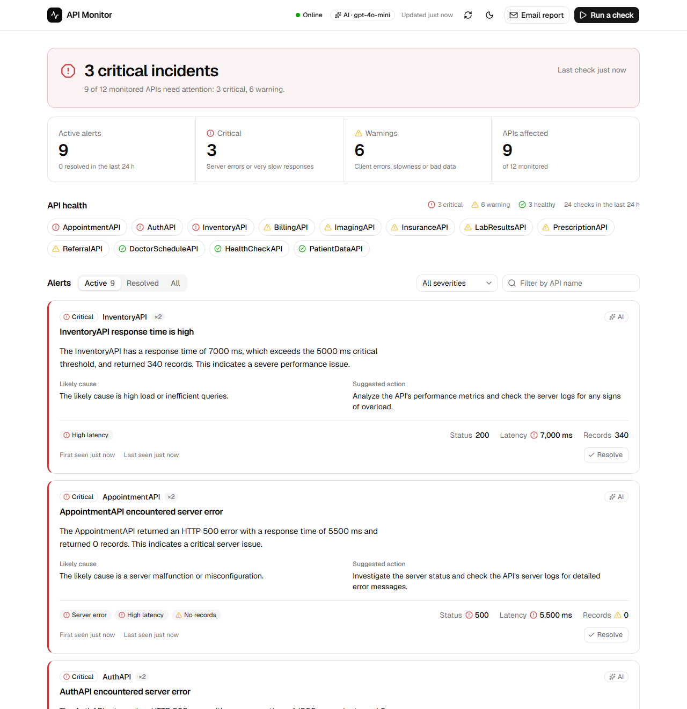
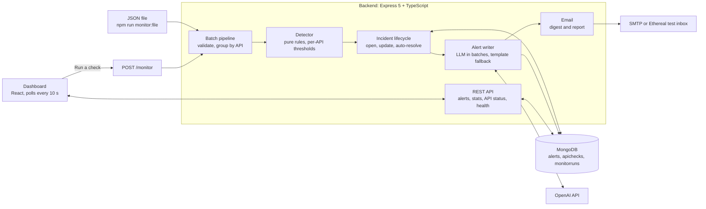

# API Monitor

Intelligent API monitoring and alerting for a healthcare company's integrations. Feed it the results of API calls (response time, HTTP status, records returned). Rules find the anomalies, an LLM writes the alert an on-call engineer reads, and a live dashboard shows what is broken and what to do about it.

<picture>
  <source media="(prefers-color-scheme: dark)" srcset="docs/screenshots/dashboard-dark.png">
  
</picture>

## Features

- **Two ways in.** `POST /monitor` on the API, or a JSON file through `npm run monitor:file`. Both run the same batch pipeline.
- **Rule-based detection.** Server and client errors, unexpected statuses, high latency (warning and critical), and empty, missing or malformed data, with per-API thresholds.
- **AI-written alerts.** The OpenAI API writes a title, a message, a likely cause and a suggested action for each alert, many alerts per call. A deterministic template takes over whenever there is no key or the call fails.
- **Incidents, not noise.** One active alert per API. Repeats add to its occurrence count, and a healthy check resolves it automatically.
- **Dashboard.** A status banner, alert counts, API health, filterable alerts you can resolve, a panel to run checks, and light and dark mode. It refreshes every 10 seconds.
- **Email.** A digest after any batch with new critical alerts, and an on-demand report of all active alerts. Without SMTP settings, emails go to a free Ethereal test inbox with a preview link.
- **Built to run.** Validated configuration with safe defaults, structured logs with request IDs, central error handling, rate limits, graceful shutdown and tests.

## Architecture



The backend is layered as routes → controllers → services → models. The detector is a pure function with no I/O, so every rule is unit-tested without a database or network.

## Key design decisions

1. **Rules detect, AI explains.** Detection is deterministic and testable. The LLM never decides whether something is wrong; it only turns detected facts into a clear alert. A wrong or missing LLM answer can therefore never hide or invent an incident.
2. **One incident per API, deduplicated in the database.** A partial unique index on `apiName` (where `status` is `active`) guarantees at most one active alert per API, even when batches run at the same time. A repeat increments `occurrences` and updates the latest metrics instead of creating a new alert.
3. **Auto-resolve on recovery.** When an API with an active alert passes a check, the alert is resolved with `resolvedBy: "auto-recovery"`. A person can also resolve it, and the dashboard shows who or what did.
4. **LLM batching and fallback.** Every alert that needs text goes to the LLM in chunks of `LLM_BATCH_SIZE` (one call for the 9 sample alerts). Text is regenerated only when an alert's issue types change or its severity escalates, which saves calls. Structured output with a strict JSON schema, a 0.2 temperature, a timeout and one retry keep answers reliable. Any alert the LLM misses or answers badly gets the template text, so a batch never fails because of the LLM.
5. **Privacy.** This is healthcare data, so the LLM only ever sees metrics: the API name, status code, response time, record count, the detected issues and the thresholds. Raw payloads are never sent, and malformed string values are described ("got a string") rather than echoed into the alert or the prompt.

## Tech stack

| Area | Choice |
|---|---|
| Backend | Node.js, Express 5, TypeScript 7 (ESM), Mongoose 9, zod 4, pino, OpenAI SDK, nodemailer |
| Database | MongoDB 7 in Docker |
| Frontend | Vite 8, React 19, TypeScript, Tailwind CSS v4, shadcn/ui (Radix), TanStack Query, date-fns, sonner |
| Tests | Vitest |

## Prerequisites

- Node.js 22.12 or newer (developed on Node 24) and npm
- Docker Desktop, for MongoDB
- Optional: an OpenAI API key. Without one, alerts use template text.
- Optional: SMTP settings. Without them, emails go to an Ethereal test inbox.

## Setup and run

1. Install the dependencies:
   ```powershell
   npm install
   ```
2. Start MongoDB 7 in Docker (it waits until the database is healthy):
   ```powershell
   npm run db:up
   ```
3. Optional, for AI-written alerts: create `backend/.env` from the example, then set `OPENAI_API_KEY=...` in it. Do this only once, because the copy overwrites an existing `.env`.
   ```powershell
   copy backend\.env.example backend\.env      # macOS/Linux: cp backend/.env.example backend/.env
   ```
4. Start the backend and the dashboard:
   ```powershell
   npm run dev
   ```
5. Open the dashboard at **http://localhost:5173** and click **Run a check** to send the sample batch. The API is at **http://localhost:4000** (try http://localhost:4000/health).

Every setting is optional and has a safe default, so the app runs without a `.env` file. The header shows **Template mode** without a key and **AI · gpt-4o-mini** with one. If you add the key while the app is running, restart `npm run dev`.

To stop: press Ctrl+C in the `npm run dev` terminal, then run `npm run db:down`.

## npm scripts

Run them from the project root.

| Script | What it does |
|---|---|
| `npm run dev` | Runs the backend (with reload) and the dashboard together |
| `npm run build` | Builds the backend (TypeScript) and the dashboard (Vite) |
| `npm test` | Type-checks and runs the backend tests |
| `npm run db:up` / `npm run db:down` | Starts / stops MongoDB with docker compose (data is kept in a volume) |
| `npm run db:reset` | Deletes all monitoring data and starts a fresh MongoDB. Stop `npm run dev` first. |
| `npm run monitor:file -- [path]` | Runs a JSON file through the pipeline and prints a summary (default: `sample-data/sample-batch.json`) |
| `npm run prompts:docx` | Regenerates `AI_Prompts.docx` from `prompts/AI_PROMPTS.md` |

## Detection rules

| Issue | When | Severity |
|---|---|---|
| `SERVER_ERROR` | status ≥ 500 | critical |
| `CLIENT_ERROR` | status 400–499 | warning |
| `UNEXPECTED_STATUS` | status 1xx or 3xx | warning |
| `HIGH_LATENCY` | response time > warning threshold (default 2000 ms) | warning |
| `HIGH_LATENCY` | response time > critical threshold (default 5000 ms) | critical |
| `EMPTY_DATA` | 0 records, for an API expected to return records | warning |
| `MISSING_DATA` | `records_returned` missing or null | warning |
| `INVALID_DATA` | a malformed field (status not an integer from 100 to 599, negative or non-numeric time or records) | warning |

A check's severity is its worst issue; a check with no issues is healthy. Per-API rules live in `backend/src/config/thresholds.ts`: PatientDataAPI alerts sooner (1500 / 3000 ms), and HealthCheckAPI may return 0 records.

Only a missing or blank `api_name` makes an item invalid: it is skipped and listed in `invalid`, and the rest of the batch runs. Every other problem is reported as an anomaly. Extra fields are ignored.

## API reference

Base URL `http://localhost:4000`. There is no `/api` prefix.

> **PowerShell note:** in Windows PowerShell, `curl` is an alias for `Invoke-WebRequest`, so type `curl.exe`. Send JSON from a file (`--data-binary "@file.json"`), because Windows PowerShell mangles quotes in inline JSON.

### POST /monitor

Accepts one result or an array of them, and returns the batch outcome. Rate limited to 30 requests a minute per client.

```powershell
curl.exe -X POST http://localhost:4000/monitor -H "Content-Type: application/json" --data-binary "@sample-data/sample-batch.json"
```

```json
{
  "runId": "6650f0c2a1b2c3d4e5f60718",
  "received": 13,
  "processed": 12,
  "invalid": [{ "index": 12, "reason": "api_name is missing" }],
  "healthy": 3,
  "anomalies": 9,
  "alerts": { "created": 9, "updated": 0, "autoResolved": 0 },
  "llm": { "mode": "ai", "calls": 1, "fallbacks": 0 },
  "durationMs": 8531,
  "results": [
    { "apiName": "PatientDataAPI", "healthy": true, "severity": "healthy", "issues": [] },
    {
      "apiName": "AppointmentAPI",
      "healthy": false,
      "severity": "critical",
      "issues": [
        { "type": "SERVER_ERROR", "severity": "critical", "detail": "HTTP 500 server error" },
        { "type": "HIGH_LATENCY", "severity": "critical", "detail": "Response time 5500 ms is above the 5000 ms critical threshold" },
        { "type": "EMPTY_DATA", "severity": "warning", "detail": "Returned 0 records" }
      ]
    }
  ]
}
```

An empty array returns 400, more than `MAX_BATCH_SIZE` items returns 413, and a batch where every item is invalid returns 400 with the reasons.

### GET /alerts

Active alerts by default, critical first, then most recently seen.

| Query | Values |
|---|---|
| `status` | `active` (default), `resolved`, `all` |
| `severity` | `critical`, `warning` |
| `apiName` | case-insensitive "contains" match |
| `limit`, `page` | `limit` 1–500 (default 100), `page` from 1 |

```powershell
curl.exe "http://localhost:4000/alerts?status=all&severity=critical&apiName=appoint"
```

```json
{
  "data": [
    {
      "id": "6a1c7e3f9b2d4c5e6f708192",
      "apiName": "AppointmentAPI",
      "status": "active",
      "severity": "critical",
      "issues": [{ "type": "SERVER_ERROR", "severity": "critical", "detail": "HTTP 500 server error" }],
      "title": "AppointmentAPI has a server error",
      "message": "The AppointmentAPI encountered a critical HTTP 500 server error with a response time of 5500 ms and returned 0 records. This is a critical issue that needs immediate attention.",
      "likelyCause": "The server error is likely due to an internal application issue.",
      "suggestedAction": "Inspect the API's server logs for detailed error information.",
      "aiGenerated": true,
      "aiModel": "gpt-4o-mini",
      "lastMetrics": { "statusCode": 500, "responseTimeMs": 5500, "recordsReturned": 0 },
      "occurrences": 2,
      "firstSeen": "2026-10-24T14:31:05.112Z",
      "lastSeen": "2026-10-24T14:33:40.871Z",
      "resolvedAt": null,
      "resolvedBy": null,
      "createdAt": "2026-10-24T14:31:05.198Z",
      "updatedAt": "2026-10-24T14:33:40.902Z"
    }
  ],
  "total": 1,
  "page": 1,
  "limit": 100
}
```

### Other endpoints

| Endpoint | What it does |
|---|---|
| `GET /alerts/stats` | `{ active, critical, warning, apisAffected, resolvedLast24h, checksLast24h }` |
| `GET /alerts/:id` | One alert. 400 for a malformed id, 404 if it doesn't exist. |
| `PATCH /alerts/:id/resolve` | Resolves an alert (`resolvedBy: "user"`). Idempotent: resolving twice returns the same alert. |
| `POST /alerts/report/email` | Emails a report of all active alerts. Returns `{ sent, alerts, to, messageId, previewUrl }`. Rate limited to 5 a minute. |
| `GET /apis/status` | The latest check of every API, with its severity, metrics and active alert, if any |
| `GET /health` | `{ status, db, llm, model, uptimeSec }`. Answers 503 with `status: "degraded"` while MongoDB is down. |

```powershell
curl.exe -X PATCH http://localhost:4000/alerts/6a1c7e3f9b2d4c5e6f708192/resolve
curl.exe -X POST http://localhost:4000/alerts/report/email
curl.exe http://localhost:4000/apis/status
```

### Errors

Every error has the same shape, and every response carries an `X-Request-Id` header that matches the logs:

```json
{ "error": { "code": "VALIDATION_ERROR", "message": "The batch is empty", "requestId": "5f0c9d1e-2b7a-4c3d-9e8f-1a2b3c4d5e6f" } }
```

Some errors add `details`: an invalid query or id lists each problem (for example `[{ "path": "id", "message": "must be a 24-character hexadecimal alert id" }]`), and a batch where every item is invalid lists them in `details.invalid`.

| Code | Status | When |
|---|---|---|
| `VALIDATION_ERROR` | 400 | Invalid body, query or id |
| `INVALID_JSON` | 400 | The body is not valid JSON |
| `NOT_FOUND` | 404 | Unknown route or alert |
| `PAYLOAD_TOO_LARGE` | 413 | Body over 1 MB, or more than `MAX_BATCH_SIZE` items |
| `RATE_LIMITED` | 429 | Too many requests |
| `EMAIL_FAILED` | 502 | The report email could not be sent |
| `DATABASE_UNAVAILABLE` | 503 | MongoDB is down |
| `INTERNAL_ERROR` | 500 | Anything unexpected (the stack is shown only outside production) |

## Sample data and file input

`sample-data/` holds two batches, used by the CLI, the dashboard's "Run a check" panel and the demo:

- **`sample-batch.json`**: the two examples from the task plus results that trigger every rule: a slow API, a very slow one, empty, missing and malformed data, a 404, a 503, a 302, healthy APIs, an API exempt from the empty-data rule, and one item without `api_name`. Expect 13 received, 12 processed, 3 healthy and 9 anomalies.
- **`recovery-batch.json`**: the same APIs, all healthy. Send it after the sample to watch every alert auto-resolve.

The file CLI is the task's first input method. It runs the same pipeline as `POST /monitor` and prints a table:

```powershell
npm run monitor:file                                    # sample-data/sample-batch.json
npm run monitor:file -- sample-data/recovery-batch.json
```

It logs only warnings and errors, so the table is the output; set `LOG_LEVEL=debug` to see every log line. With `EMAIL_ENABLED=true`, it also waits for the digest email and prints its preview link.

## Email reports

- **Digest:** with `EMAIL_ENABLED=true`, any batch that opens or escalates critical alerts sends one email listing them: API, severity, the AI message and the suggested action.
- **On demand:** the dashboard's **Email report** button (or `POST /alerts/report/email`) emails all active alerts.
- **No SMTP needed for a demo:** without `SMTP_HOST`, the backend creates a free [Ethereal](https://ethereal.email) test account. Nothing is delivered; the dashboard's toast and the backend log give a link to view the email in Ethereal's web inbox.
- **Never in the way:** email failures are logged and never fail a batch.

## Testing

```powershell
npm test
```

96 Vitest tests cover:

- **Detector:** every rule, the threshold boundaries, combinations and per-API overrides.
- **Input:** normalization and validation.
- **Alert writer:** fallback when the OpenAI client throws, refuses or returns malformed or missing items. The client is mocked.
- **Templates and email:** template text, including the example alert from the task, email rendering, and a digest that never fails a batch, even when sending or the database read fails (mocked).

The tests are type-checked first and run on default settings, whatever your `.env` contains.

## Logging

The backend logs with pino:

- **Console:** readable, coloured lines in development and JSON in production.
- **`backend/logs/app.log`:** a JSON copy of every line.
- **Requests:** each request gets an ID (sent back in `X-Request-Id`), and authorization headers and cookies are redacted.
- **What else is logged:** each batch summary, LLM latency, token use and fallbacks, auto-resolves, emails sent (with preview links), and the startup configuration, never with secrets.

Set `LOG_LEVEL=debug` to also see the dashboard's polling requests.

## Configuration

`backend/.env` (copy it from `backend/.env.example`). Every value is optional.

| Variable | Default | Purpose |
|---|---|---|
| `PORT` | `4000` | API port |
| `MONGODB_URI` | `mongodb://localhost:27017/api_monitor` | Database |
| `CORS_ORIGIN` | `http://localhost:5173` | Allowed dashboard origin(s), comma-separated |
| `LOG_LEVEL` | `info` | `fatal` … `trace`, or `silent` |
| `OPENAI_API_KEY` | empty | Empty means template mode |
| `OPENAI_MODEL` | `gpt-4o-mini` | Model for alert text |
| `LLM_TIMEOUT_MS` / `LLM_BATCH_SIZE` | `15000` / `20` | Timeout per call, and alerts per call |
| `AUTO_RESOLVE_ON_RECOVERY` | `true` | Resolve an alert when its API is healthy again |
| `MAX_BATCH_SIZE` | `1000` | Most results per request |
| `EMAIL_ENABLED` | `false` | Send the digest email after batches |
| `EMAIL_TO` / `EMAIL_FROM` | empty | Recipients and sender (Ethereal accepts any) |
| `SMTP_HOST` / `SMTP_PORT` / `SMTP_USER` / `SMTP_PASS` | empty / `587` | Real SMTP; leave `SMTP_HOST` empty for Ethereal |

The dashboard reads `VITE_API_URL` (default `http://localhost:4000`) from `frontend/.env`; see `frontend/.env.example`.

## Scaling plan

The code already processes a 1,000-result batch across 200 APIs in about 1.4 seconds on a laptop (template mode). To monitor many more APIs:

1. **Queue the work.** `POST /monitor` would put the batch on a queue (for example BullMQ on Redis) and answer 202 with a run ID. Workers process batches in parallel, with each API's results keyed to one worker so they stay in order.
2. **Scale the API horizontally.** The API instances are stateless. Run several behind a load balancer and move the rate limiter's counters to Redis.
3. **Keep MongoDB fast.** The hot queries are already indexed (active alerts by severity and recency, latest check per API), and a TTL index drops checks after 30 days. Next steps: keep a small "latest status per API" collection updated on each check instead of aggregating, then a replica set, and sharding by `apiName`.
4. **Control the LLM.** Cap concurrent calls and tokens per minute to the provider's limits, cache alert text by API, issue types and severity, and switch to templates automatically while OpenAI is slow or failing (a circuit breaker). Text is already regenerated only when an alert changes.
5. **Push instead of poll.** Server-sent events would update the dashboard immediately, without polling.

## Project structure

```
api-monitor/
├─ backend/                      Express 5 + TypeScript API
│  ├─ src/
│  │  ├─ server.ts               startup, graceful shutdown
│  │  ├─ app.ts                  Express app (middleware and routes)
│  │  ├─ config/                 env.ts (zod-validated settings), thresholds.ts (per-API rules)
│  │  ├─ domain/                 shared types: issues, severities, metrics
│  │  ├─ db/                     MongoDB connection and indexes
│  │  ├─ models/                 Alert, ApiCheck, MonitorRun
│  │  ├─ modules/                monitor (batch pipeline), alerts, apis, health:
│  │  │                          routes → controllers → services
│  │  ├─ services/               detector.ts (pure rules), llm/ (alert writer, prompts,
│  │  │                          templates), notifier/ (email)
│  │  ├─ middleware/             request logging, errors, 404, rate limits
│  │  ├─ lib/                    logger, errors, validation helpers
│  │  └─ cli/monitorFile.ts      file input
│  ├─ tests/                     Vitest suites
│  └─ .env.example
├─ frontend/                     Vite + React dashboard
│  └─ src/
│     ├─ components/dashboard/   header, status banner, tiles, API health, alerts, run-check panel
│     ├─ components/ui/          shadcn/ui components
│     ├─ hooks/                  TanStack Query hooks, theme
│     ├─ lib/                    api.ts (typed client), formatting, sample batches
│     └─ types.ts                API response types
├─ sample-data/                  sample and recovery batches
├─ prompts/AI_PROMPTS.md         every AI prompt used (source of AI_Prompts.docx)
├─ scripts/build-prompts-docx.mjs
├─ docs/                         video outline, screenshots
├─ docker-compose.yml            MongoDB
└─ AI_Prompts.docx
```

## AI usage

- **Planning:** Claude (claude.ai) analysed the task and wrote [`BUILD_SPEC.md`](BUILD_SPEC.md).
- **Building:** Claude Code built the project in four phases.
- **Prompt log:** every prompt is recorded verbatim, with its outcome, in [`prompts/AI_PROMPTS.md`](prompts/AI_PROMPTS.md) and in **`AI_Prompts.docx`** (regenerate it with `npm run prompts:docx`).
- **Runtime:** the app uses the OpenAI API to write alert text. The exact system prompt and message template are documented in the same file, under "Runtime LLM prompt".
